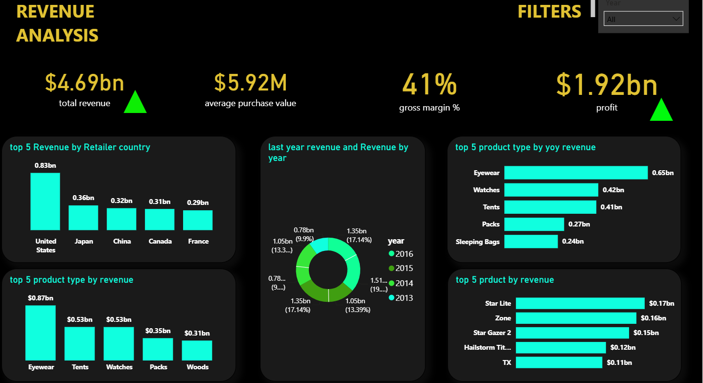
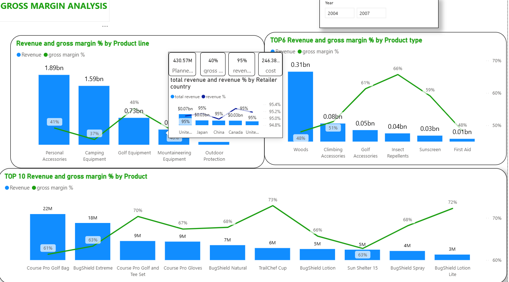
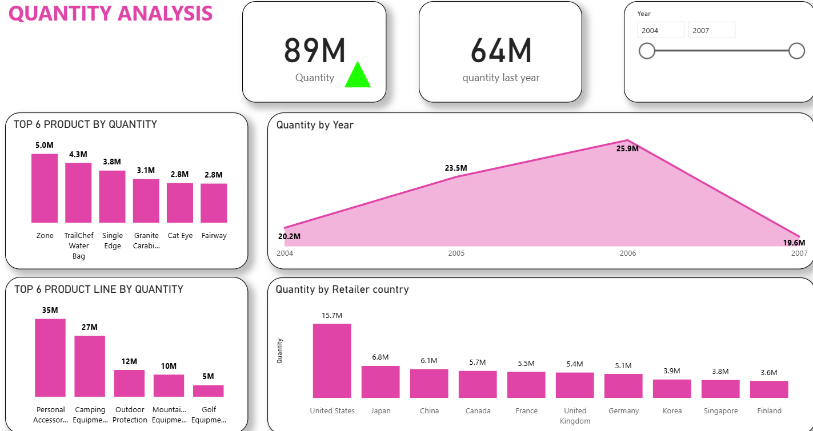
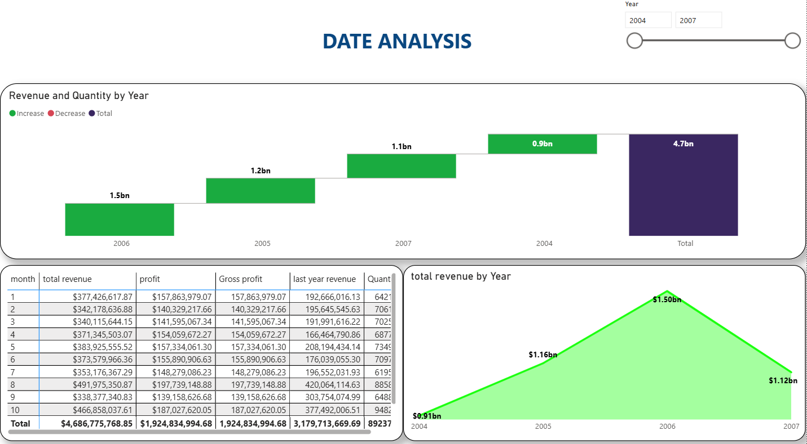

# Business Performance Intelligence

### Multi-page Power BI Business Performance Dashboard

An interactive, multi-page Power BI dashboard analyzing revenue, gross profit, gross margin, sales quantity, and year-over-year performance across products, product lines, and countries.

## Overview

This project explores business performance using four report pages: **Revenue Analysis**, **Gross Margin Analysis**, **Quantity Analysis**, and **Date Analysis**. It provides multiple views of sales and profitability, with breakdowns by product, product category, country, and year.

## Dashboard Preview

### Revenue Analysis


### Gross Margin Analysis


### Quantity Analysis


### Date Analysis


## Report Pages

| Page | Focus |
| --- | --- |
| **Revenue Analysis** | Total revenue, profit, gross margin percentage, average purchase value, and top-performing countries and products |
| **Gross Margin Analysis** | Revenue and gross margin percentage across product lines, product types, and individual products |
| **Quantity Analysis** | Sales quantity, prior-year quantity, yearly trends, and product and country comparisons |
| **Date Analysis** | Revenue across years, a month-level metrics table, and a revenue waterfall visualization |

## Tools and Techniques

- **Microsoft Power BI Desktop** — interactive report development
- **DAX measures** — business KPIs and year-over-year comparisons
- **Data visualization** — KPI cards, bar and column charts, combination charts, area charts, waterfall charts, and tables
- **Interactive reporting** — year filters and report tooltips

## Files

```text
business-performance-intelligence/
├── README.md
├── dashboard/
│   └── business-performance-intelligence.pbix
└── images/
    ├── revenue-analysis.png
    ├── gross-margin-analysis.png
    ├── quantity-analysis.png
    └── date-analysis.png
```

## Open the Report

1. Download `dashboard/business-performance-intelligence.pbix`.
2. Open it using **Microsoft Power BI Desktop**.
3. Explore the four report pages and use the available year filters.

**Data availability:** The original standalone source dataset is not included in this repository. The PBIX contains a saved Power BI data model; availability of refresh from the original source is not guaranteed.

## Notes

This repository documents the existing Power BI analysis. It does not claim an independent data engineering pipeline or verified business outcomes. Metrics and date fields are presented as implemented in the original report.

## Author

[Omar Ali](https://github.com/omaraligomaa)
